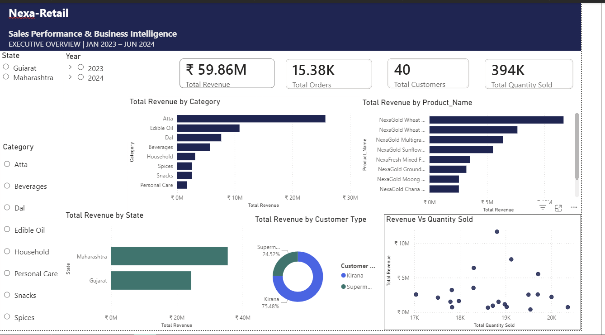

# Nexa-Retail

Exploratory data analysis of NexaRetail's sales data using MySQL and Python — covering revenue trends, store performance, seasonality, return-rate risk, and product insights. Extended with customer segmentation (RFM), a full A/B test analysis for the NexaRetail loyalty app, and an interactive Power BI executive dashboard.

## Project Overview

This repo simulates a full analyst workflow on NexaRetail's retail data, moving from diagnosis to action:

  1. SQL — answer the concrete business questions a store manager would ask first
  2. Python EDA — go deeper into revenue drivers, seasonality, and return risk
  3. RFM Segmentation — find out who is driving that revenue, and who's at risk of leaving
  4. A/B Testing — validate whether a product change (a registration page redesign) actually worked, or was just noise
  5. Power BI Dashboard — bring the sales picture together in one interactive view that leadership can filter and explore on their own

Each stage ends in a plain-language recommendation, not just a chart — the goal throughout is answers a manager or PM could act on, not just analysis for its own sake.

## 🛒 NexaRetail Sales Analysis

A data analysis project built on real retail transaction data from NexaRetail, a fictional FMCG distributor operating across 10 cities in Maharashtra and Gujarat. The goal was to answer the business questions a real retail manager or business owner would actually care about — first in SQL, then extended with a full Python EDA, customer segmentation, A/B test analysis, and a Power BI dashboard.

## 📁 What's in this Repository

- `Nexa_Retail_Raw` → Zip file, raw data, 16 excel files
- `Nexa_Retail_Consolidated` → Consolidated excel file, cleaned dataset, 15,380 rows of sales transactions
- `Nexa_Retail_SQL.sql` → All SQL queries written to answer the 10 business questions
- `NexaRetail_insights_SQL.pdf` → Final SQL report with results and plain-language business takeaways
- `NexaRetail_EDA_Portfolio.ipynb` → Python EDA notebook covering revenue drivers, monthly/weekly seasonality, return-rate analysis, and a Business Opportunity Matrix
- `NexaRetail_Findings_Python.pdf` → 2-page summary of the 3 most consequential business observations from the Python EDA, each with a chart and a recommendation
- `NexaRetail_RFM`→ Customer segmentation notebook using Recency, Frequency, Monetary (RFM) analysis on loyalty program data
- `NexaRetail_ABtesting`→ Full A/B test analysis of a loyalty app registration page redesign, with significance testing and segmented results
- `NexaRetail_Verdict`→ 1-page ship/no-ship verdict summarizing the A/B test for a product manager
- `NexaRetail_Dashboard.pbix` → Interactive Power BI executive dashboard built on the consolidated dataset
- `images/nexaretail_dashboard.png` → Dashboard screenshot used in this README

## 📊 About the Dataset

- 15,380 sales transactions, ₹5.99 crore total revenue (consolidated dataset used for SQL and the dashboard)
- 40 store names, each trading in all 10 cities (400 store–city combinations)
- 10 cities across 2 states — Maharashtra (Pune, Nagpur, Nashik, Solapur, Kolhapur, Aurangabad) and Gujarat (Ahmedabad, Surat, Vadodara, Rajkot)
- 2 store types — Kirana stores (30) and Supermarkets (10)
- Covers Jan 2023 – Jun 2024 across 16 monthly files (June 2023 and February 2024 are not in the source data)
- Each row contains: Order Date, Store Name, Store Type, City, State, Product, Category, Quantity Sold, Unit Price, and Revenue
- Note: the Python EDA uses a separate order-level dataset (11,875 orders, Jan–Dec 2023) that also includes channel and return fields, so its totals differ from the SQL and dashboard figures

## ❓ SQL: Business Questions Answered

Q1. What is the total revenue for 2023, broken down by quarter?
Q2. Which are the top 5 stores by total revenue? Are they all in the same city?
Q3. Which product category earns the most money per sale?
Q4. How many stores consistently met their monthly targets? (skipped — target data not available)
Q5. How did revenue grow or drop month by month? Which month had the worst fall?
Q6. Which city has customers spending the most per visit? Which has the least?
Q7. Do Kirana stores or Supermarkets bring in more revenue per store?
Q8. Which 3 products are steadily losing sales volume month after month?
Q9. What share of total revenue comes from just the top 10% of stores?
Q10. If the 3 weakest products were removed, how much revenue would be lost?

### 💡 Key Findings (SQL)

- Q3 (Jul–Sep) was the strongest quarter — about ₹1.22 crore in revenue, making it the most important period to have stock ready and promotions running. (Q2 looks weak only because June 2023 is missing from the data.)
- Top 5 stores are spread across 5 different cities — a healthy sign that the business isn't depending too much on any one location.
- Atta is the highest-value category — customers spend nearly ₹12,000 per purchase on average, making it the best candidate for premium placement.
- August 2023 saw the sharpest month-over-month revenue drop at -21% (October 2023 was close at -19%) — worth investigating for causes like seasonal dips or supply issues. Months next to the two missing months are excluded from the comparison.
- Solapur customers spend the most per visit (~₹4,093); Kolhapur the least (~₹3,764) — a modest gap, but different cities may still need different strategies.
- Kirana stores and Supermarkets earn almost the same revenue per store (~₹15.1 lakh vs ~₹14.7 lakh). Kirana stores bring in 75% of total revenue and Supermarkets 25%, in line with their share of stores — neither format is clearly more efficient.
- The three products with the weakest average month-over-month change show no real decline on that measure. Comparing the first five and last five months of data, the clearest decliners are NexaCrunch Mixture 200g (-15%), NexaFresh Mango Juice 1L (-12%), and NexaGold Moong Dal 1kg (-9%) — worth watching.
- The top 10% of stores (4 of 40) generate 11.2% of total revenue, and the single largest store is only 2.9% — revenue is spread evenly, so there is no single-store dependency risk.
- Removing the bottom 3 products would only cost ~3% of revenue — a safe trade-off for freeing up space.

## 📓 Python EDA: Extended Analysis

The SQL project answered 10 targeted business questions. The Python notebook (`NexaRetail_EDA_Portfolio.ipynb`) goes deeper — full exploratory analysis with polished, presentation-ready visuals, run on a separate order-level dataset of 11,875 orders (Jan–Dec 2023) that includes sales channel and return details — covering:

- Revenue distribution across city, store type, category, and channel (online vs offline)
- Monthly and weekly seasonality patterns
- Return-rate analysis by category, city, and product
- Correlation between basket size, channel, and store type
- A Business Opportunity Matrix (revenue share vs return rate by category)
- A city-level Revenue-Risk analysis identifying which top revenue product carries the most exposure in each city

### 💡 Key Findings (Python EDA)

- Total revenue: ₹4.77 crore across 11,875 orders (returned orders are flagged, not removed from this total), with a 37.4% return rate — high enough to be a top operational priority.
- Revenue is driven by order volume, not order value — average order value barely moves city to city, but order counts do.
- Atta and Personal Care combine solid revenue share with the highest return rates of any category (~38–39%).
- Rajkot's top revenue product, NexaGold Wheat Atta 5kg, carries the largest combined revenue-at-risk of any city's top product — a 40.3% return rate on a product worth 9.2% of the city's total revenue.
- Basket size doesn't vary meaningfully by channel or store type — Online/Offline and Kirana/Supermarket customers buy about the same quantity per order.

A standalone 2-page summary of the three most important findings — each with its own chart and recommendation — is available in `NexaRetail_Findings_Python.pdf`.

## 🎯 RFM Segmentation: Who Are Our Best (and Riskiest) Customers?

The EDA answered *what's happening* in the business. `NexaRetail_RFM.ipynb` answers *who's driving it* — segmenting NexaRetail's 2,500 loyalty members by Recency, Frequency, and Monetary value (19,113 transactions, quartile-scored) into six named, business-readable segments, each with a revenue figure and a recommended action.

### 💡 Segment Breakdown & Recommended Actions

| Segment | Customers | % of Revenue | Recommended Action |
|---|---|---|---|
| **Champions** | 721 (28.8%) | **51.7%** | Reward with VIP benefits, early access, and referral incentives — protect this group above all else. |
| **At Risk** | 421 (16.8%) | **34.9%** (~₹50.6M) | Launch a personalized win-back campaign with limited-time discounts — the single highest-leverage move available. |
| **Need Attention** | 677 (27.1%) | 6.0% | Nurture with personalized recommendations to convert this large, low-value group toward Loyal. |
| **Loyal** | 295 (11.8%) | — | Encourage higher spend via upselling and bundle offers. |
| **Lost** | 315 (12.6%) | *combined* | Minimize spend — include only in broad awareness campaigns. |
| **Hibernating** | 71 (2.8%) | **<3%** | Low-cost re-engagement only (reminder emails, light promotions). |

### 🔎 At Risk Deep-Dive

The brief specifically called for quantifying what's recoverable in the At Risk segment. The key finding: **At Risk customers look almost identical to Champions on frequency and spend — the only real difference is recency.** These are high-value customers who simply stopped buying recently (avg. 118 days since last purchase), not low-value customers to write off. That's exactly the profile a win-back campaign is built for, which is why this segment — not Hibernating or Lost — gets priority budget.

- **721 Champions** drive 51.7% of revenue from just 28.8% of customers — losing this group would hurt more than losing any other segment.
- **421 At Risk customers** hold ₹50.6M (34.9%) in still-recoverable revenue — the single largest revenue-recovery opportunity in the loyalty base.
- **Lost + Hibernating** (386 customers combined) contribute under 3% of revenue — not worth active marketing spend.

Full customer-level R/F/M scores and segment labels are exported to `NexaRetail_Segments.xlsx` for a campaign team to action directly.

## 🧪 A/B Testing: Did the New Registration Page Actually Win?
NexaRetail's product team redesigned the loyalty app's registration page and ran a 30-day A/B test — 10,000 visitors, 50/50 Control vs. Treatment split. NexaRetail_ABTest.ipynb runs the full statistical analysis; NexaRetail_Verdict.pdf distills it into a 1-page ship/no-ship recommendation for a product manager.

  - Two-proportion z-test with p-value and 95% confidence interval for the conversion lift
  - Absolute and relative effect size calculation
  - Segmented analysis by device type and traffic source
  - Explicit Simpson's paradox check to confirm the overall result isn't an aggregation artifact

### 💡 Key Findings (A/B Test)
  - Conversion rose from 2.74% (Control) to 3.60% (Treatment) — a +0.86 percentage point, +31.6% relative lift, statistically significant at p = 0.0136.
  - The lift held directionally across every device and every traffic channel tested — no segment reversed direction, ruling out Simpson's paradox.
  - Strongest, statistically confirmed gains were on mobile (~49% relative lift), the largest traffic segment; Google Ads traffic was the one channel showing essentially no lift.
  - Verdict: ship the new page to 100% of users, while monitoring mobile performance and Google Ads conversion post-launch.

## 📈 Power BI Dashboard: Sales Performance & Business Intelligence

The SQL, Python, RFM, and A/B work each answer a specific question. The Power BI dashboard (`NexaRetail_Dashboard.pbix`) pulls the sales story into a single executive overview, so a manager can slice the numbers themselves instead of waiting on a new query or notebook. It is built on the consolidated dataset (Jan 2023 – Jun 2024, 16 months of data), the same data used for the SQL analysis.

### What's on the Dashboard

| Metric | Value |
|---|---|
| Total Revenue | ₹59.86M |
| Total Orders | 15.38K |
| Total Customers (stores) | 40 |
| Total Quantity Sold | 394K |

- Total Revenue by Category — ranks the eight categories by revenue, with Atta clearly ahead (43%), followed by Edible Oil (18%) and Dal (13%).
- Total Revenue by Product — shows which individual products carry the business; NexaGold Wheat Atta 10kg alone contributes 19.5% of revenue.
- Total Revenue by State — Maharashtra contributes ₹35.5M (59%) and Gujarat ₹24.4M (41%).
- Total Revenue by Customer Type — Kirana stores account for 75.48% of revenue and Supermarkets for 24.52%.
- Revenue vs Quantity Sold — a scatter plot by product showing that volume doesn't drive revenue: every product sells roughly 17K–20K units, but product revenue ranges from ₹0.4M to ₹11.7M.
- Interactive filters — State (Gujarat / Maharashtra), Year (2023 / 2024), and Category (Atta, Beverages, Dal, Edible Oil, Household, Personal Care, Snacks, Spices). Every visual responds to these slicers.

### 💡 Key Takeaways (Dashboard)

- Atta is the revenue engine — 43% of total revenue, matching the SQL finding that Atta is the highest-value category.
- Revenue is concentrated in a handful of products — the top 5 products generate 58% of revenue, so stock-outs on them carry outsized risk.
- Maharashtra is the larger market (59% of revenue), but Gujarat is a substantial second market — state-level planning matters.
- Kirana stores bring in three-quarters of revenue, in line with their 75% share of stores — per-store revenue is nearly identical across both formats.
- Volume does not equal revenue — products with similar units sold differ up to 30x in revenue, which points to pricing and premium placement rather than simply pushing more units.

## 🛠️ Tools Used

- MySQL — for writing and running all SQL queries
- MySQL Workbench — for managing the database and importing data
- Python (Pandas, Matplotlib, Seaborn) — for the extended EDA notebook
- Python (ReportLab) — for generating both PDF reports
- Power BI — for the interactive executive dashboard

## 🧠 SQL Concepts Used

Here's what the queries cover:

- Aggregate functions (SUM, AVG, COUNT)
- Window functions (LAG, RANK, PARTITION BY) for month-over-month comparisons and rankings
- Common Table Expressions / CTEs (WITH clauses) for step-by-step query building
- UNION ALL for combining results
- CROSS JOIN for percentage calculations
- Date functions (QUARTER, YEAR, DATE_SUB)
- Data cleaning (REPLACE, ALTER TABLE, type conversion)
